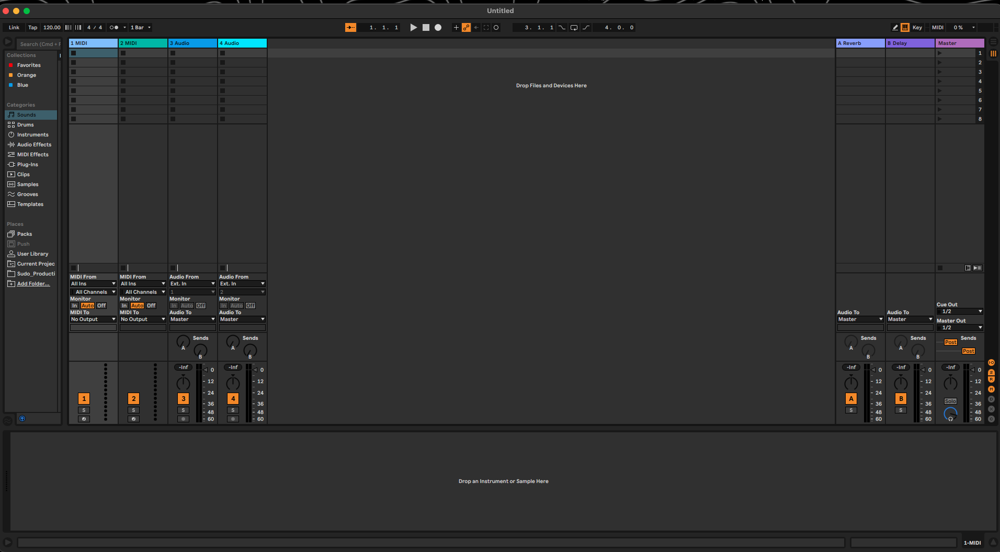
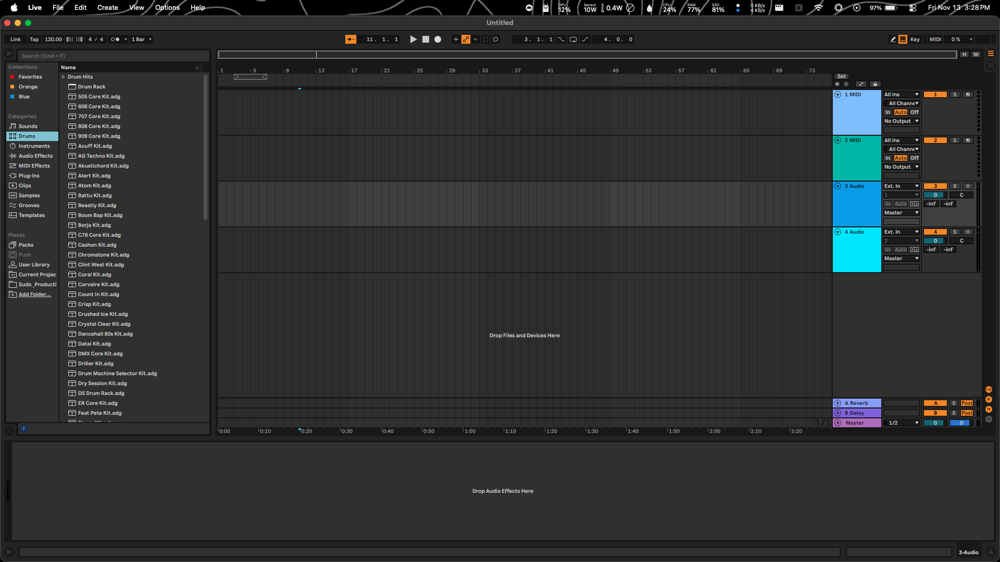
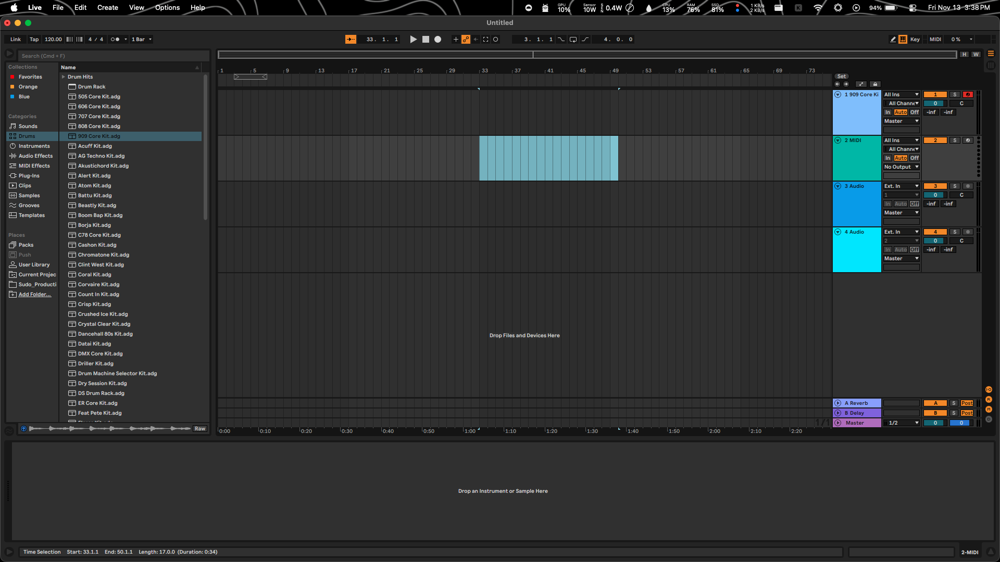
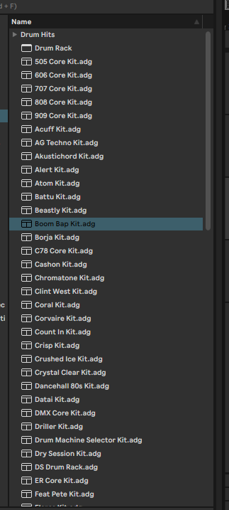
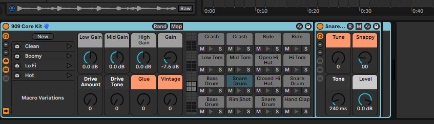
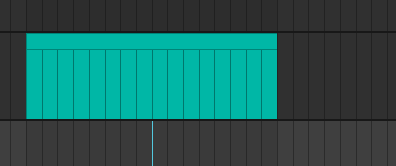
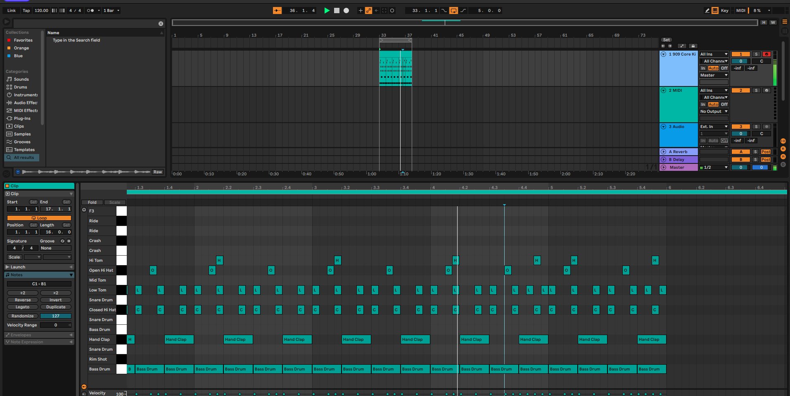

## j01 Alexes first time using Ableton ## 

As long as I could remember I was always listening to music. I was always drawn to it. Especially once I discovered electronic music. Something about the futuristic computer sounds that scratched the itch in my brain. I would consume all forms of it. Didn't help when my parents bought me an ipod with music stolen from my older relatives. That was my constant pass time. As I got older I attend concerts and festivals and the love just kept on growing. Until one day one of my family members asked me. If I loved it so much why do I just make some ? That idea never crossed my mind until then. Thankfully I had older relatives that were also heavily into it that directed me to this musical software called *Ableton*. A digital audio workstation software where you could create music. As I got older and into college. I had my own money. So with that I made the purchase of Ableton and began my musical journe.

The first time opening up Ableton. I had no clue what I was looking at just sat there and tried to figure out what did what. To me it sorta looked like a spaceships dashboard. There are buttons everywhere, tiny knobs with micro numbers on them and flashing lights. In the figure above is what you are greeted to when you first open the software up. Since I was excited to start making things. I impulsively skipped the documentation and youtube video watching because I thought to myself it cant be that hard ? Oh boy was I wrong. The thing about Ableton it kinda and kinda doesn't hold your hand. Half the time is just discovery and **learnability**. 

So what we are seeing here is what is called session view. Mostly just meant for mixing and performing live. Not actually for creating tracks. I obviously didn't know that plus all music is subjective so the software doesn't indict any *signifiers* saying you are doing something wrong when it came to your actions. 

Once me aimlessly clicking around I found this. I toggle between session view and arrangement view. So going into this my **mental model** was I open the software and boom making beats and making millions. But the **conceptual model** of the program didn't match up. Splitting the views to two sessions. Not matching what I envisioned in my head. So you are already lost before you have done a signal thing. Lets be honest, nobody opens up a new program and reads the manual. You just click around and figure stuff out eventually spending too much time lost and you finally decide to watch a youtube video.

Finally switching to the other view. It started to look like what I pictured. Things started to make more sense. Naturally on the side menu you are giving options like sounds, drum kits, instruments, audio effects, etc... The gears are turning this is where I am suppose to be. Since I wanted to make a house track. I naturally went straight to the drums. Drums are the foundation of a house song. 

Opening up the drum kit menu, you are greeted with sooo many options. There are hundreds of drum kits in there and I froze again. You go through one door and then you are surprised with more doors! The thing that saved me is that Ableton plays a quick preview of each kit once clicked. The programs **feedback** saved me from aimlessly wondering around to see if I am going in the right direction. Again here you are in a vast field of options and no guide signs to point you in the right direction you just have to hope for the best. Once I found the drum kit I wanted. I went to drag it onto the arrangement view and behold I was right. Thanks to my mental model from past of experiences  of other softwares. The programs **signifier** of the mouse arrow changing into a tiny file reinsured me that I was dragging the sounds I wanted.

Then I dropped the kit. Then... nothing again. Dead silence. It went from cool thumping drums to silence. I went back to click on everything eventually the drums sounds started playing because on the kit it has the individual sounds. There no way this is how i make a drum loop I just keep click? No there must be a way to make a loop somehow. Again I was off on my discovery adventure. The **discoverability** of Ableton is quite annoying if you have not made external research. But I am hard boiled and didn't want help. So this all on me I know but thats no fun. It felt like an easter egg hunt. As i described before you are in spaceship cockpit just poking button and hoping for the best not to blow the space ship up. 

I then click and dragged and it highlighted the boxes on the screen. Cool now what it just highlights them how do I fill them in? Then I right clicked more menus yay! In there is an option to insert midi clips. That drops an empty block on the timeline that you could fill in with notes. That one right click is where pandoras box opening. This all starting to make sense and my vision was getting closer to how I pictured producing would be like boxes of sounds arranged neatly to make a song. Half of producing on Ableton is just learning Ableton. The **learnability** is a slow climb here. Once you push through the beginner learning curve, the program is full of **affordances** meaning things are showed to you how they are used. I love that Ableton includes the shortcuts on the side of things. Maybe 8 times out of time the move you think is right is right, but other instances you're kinda right but there are weird quirks to it. 

Eventually I got to the fun part making music. Dropping notes onto the grid by hand and hearing an actual beat come alive. That part finally felt good. I now completed the baby steps to a extensive and long journey to come. I was now done fighting control panels and now to the creative part.

